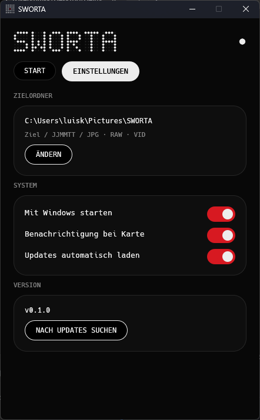

# SWORTA

A small Windows tray app that sorts your camera card for you. Plug in the card, click import, done.

Built for Sony cameras (Alpha series), where photos sit in `DCIM` subfolders and video clips hide in `PRIVATE/M4ROOT/CLIP`. SWORTA stays quiet in the tray and only speaks up when a card or USB drive with a `DCIM` folder shows up.


## What it does

Everything ends up in one folder per shooting day, split by type:

```
Destination/
└── 260112/
    ├── JPG/    .JPG from DCIM
    ├── RAW/    .ARW from DCIM
    └── VID/    .MP4 and .XML from PRIVATE/M4ROOT/CLIP
```

The folder name is the capture date as `YYMMDD`, taken from the file's modified time. A shoot that spans two days lands in two folders.

- Detects SD cards and USB drives that contain a `DCIM` folder and shows a notification
- Import from the notification or from the window
- Files that already exist at the destination (same name, same size) are skipped
- Same name but a different file gets a `_1` suffix instead of being overwritten
- Original modified times are kept
- Nothing is ever deleted from the card

## Download

Grab the latest build from [Releases](https://github.com/vxnsin/sworta/releases/latest):

- `SWORTA.exe` on its own, or
- `SWORTA.zip` with the exe and this README

No installer. Put the exe somewhere permanent (for example `Documents\SWORTA`) and run it. Windows SmartScreen will warn about an unknown publisher on first launch because the exe is not code-signed: click "More info", then "Run anyway".

## Settings



- **Destination folder**: defaults to `Pictures\SWORTA`
- **Start with Windows**: runs hidden in the tray on login
- **Notify on card**: turn it off if you would rather open the window yourself
- **Update automatically**: see below

Settings live in `%APPDATA%\SWORTA\settings.json`.

## Updates

On startup and every few hours after that, SWORTA checks this repository for a newer release. If there is one, it downloads the new exe, swaps it in and restarts itself, never in the middle of an import. If you turn off automatic updates you just get a notice with an install button. You can also check by hand under Settings.

## Build from source

Stable Rust and the MSVC build tools are enough.

```
cargo run              # development
cargo build --release  # target/release/sworta.exe
```

## Publishing a release

1. Bump `version` in `Cargo.toml`
2. Commit and push
3. Tag it: `git tag v0.2.0 && git push origin v0.2.0`

The GitHub Action builds the exe and creates the release. The tag has to match the version in `Cargo.toml` or the build fails. Every installed SWORTA picks the update up on its own.

## License

MIT
