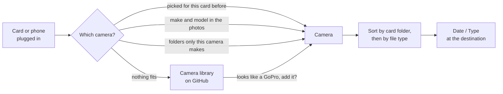

<p align="center">
  <picture>
    <source media="(prefers-color-scheme: dark)" srcset="docs/wordmark-dark.svg">
    
  </picture>
</p>

<p align="center">
  Plug in a camera card or a phone. SWORTA knows the camera and sorts it.
</p>

<p align="center">
  <a href="https://github.com/vxnsin/sworta/releases/latest"></a>
  <a href="https://github.com/vxnsin/sworta/releases"></a>
  
  <a href="LICENSE"></a>
</p>

<p align="center">
  <a href="https://github.com/vxnsin/sworta/releases/latest">Download</a> ·
  <a href="cameras">Camera library</a> ·
  <a href="cameras/README.md">Add your camera</a> ·
  <a href="https://github.com/vxnsin/sworta/releases">Changelog</a>
</p>

<p align="center">
  
</p>

Every camera lays out its card differently. A Sony hides its clips in `PRIVATE/M4ROOT/CLIP` and its proxies in `PRIVATE/M4ROOT/SUB`, a DJI Osmo Action writes a low-res copy next to every video, an iPhone has no drive letter at all. SWORTA sits in the tray, notices when a card or phone shows up, works out which camera it came from and copies everything into one folder per shooting day, split the way you set that camera up.

```
Pictures/Shoot/
└── 261102/
    ├── JPG/
    ├── RAW/
    └── VID/
        └── PROXY/
```

The day comes from the file's time, or from the file name for cameras that write it there, so a shoot over midnight lands in two folders. Nothing on the card is ever changed or deleted. Files that are already at the destination are skipped, a different file with the same name gets a `_1` instead of replacing anything, and the original times are kept. An import can be stopped at any point; what is copied stays, the half-written file goes.

## How it works



The camera never needs to be connected, the card is enough. SWORTA reads make and model from the first photo or clip, and where there is none it goes by the folders the camera left behind. A camera picked by hand is remembered for that card until the card gets formatted. Two bodies of the same brand can each have their own setup, the more specific model name wins.

## Cameras

The cameras live in this repository under [`cameras/`](cameras), one small JSON file each, in folders for action, mirrorless, cinema, drone, 360 and phone. The CAMERAS page in the app lists that library with a search, and one click adds a camera. None of it is baked into the exe, so a camera merged here reaches every SWORTA without a new release, and without internet the last list is kept.

Setting a camera up happens on the card itself. Click **Set up** and SWORTA shows what it found, like `MP4 12 · LRF 12 · JPG 30`. Each file type gets a folder or stays empty to be skipped, a whole card folder can get its own target (that is how Sony proxies end up in `VID/PROXY`), and the layout can be `date/type`, `camera/date/type` or your own. If a camera later writes a type it has no folder for yet, the card says so instead of leaving those files behind.

**Export** writes a camera out as a file and **Import file** adds it on another machine, so a colleague can hand you their setup. To add one for everybody, put the file into the right folder of [`cameras/`](cameras) with a pull request. [`cameras/README.md`](cameras/README.md) explains the format, and the tests check that a new camera loads and is recognised as itself and not as another one.

## Phones

A phone plugged in by cable shows up like a card. Unlock it, allow access if it asks, and the card fills in while SWORTA lists the files. Windows gives phones no drive letter, so they are read the way Explorer reads them, one file at a time. A full phone takes a few minutes to list, and an iPhone that keeps its photos in iCloud first has to fetch them. Unplugging in the middle stops the listing or the import cleanly.

## Notifications

When a card shows up, a small popup appears in the corner with what is on it and an import button. It turns into a progress view while the import runs. Windows notifications or no notifications at all work too, and "Preview popup" in the settings shows what it looks like.

<p align="center">
  
</p>

## Download

Get the latest build from [Releases](https://github.com/vxnsin/sworta/releases/latest). `SWORTA-Setup.exe` installs for your user only, without admin rights, with a Start menu entry and an uninstaller. `SWORTA-Portable.zip` needs no installation, unzip it somewhere permanent and run `SWORTA.exe`. Both update themselves.

> [!NOTE]
> The files are not code-signed, so Windows SmartScreen warns about an unknown publisher the first time. Click **More info**, then **Run anyway**.

<details>
<summary><b>Settings</b></summary>

<br>

<p align="center"></p>

Destination: ask on every import or use a fixed folder, and the format of the day folder. Import: speed limit, files at once per card, auto import into the last folder, open the folder when done. Notifications: popup, Windows notification or off, and how long the popup stays. System: start with Windows, hidden in the tray, and automatic updates.

Settings live in `%APPDATA%\SWORTA\settings.json`, your cameras in `%APPDATA%\SWORTA\cameras\`. The window can be pulled larger at its edges and keeps its size. If a card or phone does not behave, `%APPDATA%\SWORTA\sworta.log` says what SWORTA saw.

</details>

<details>
<summary><b>Updates</b></summary>

<br>

On startup and every few hours after that, SWORTA checks this repository for a newer release. If there is one, it downloads `SWORTA.exe`, swaps it in and restarts, never in the middle of an import. With automatic updates off you get a notice with an install button instead, and Settings can check by hand.

</details>

<details>
<summary><b>Build from source</b></summary>

<br>

Stable Rust and the MSVC build tools are enough.

```
cargo run              # development
cargo build --release  # target/release/sworta.exe
cargo test             # also checks every camera in cameras/
```

The logo and the wordmark are generated: `node docs/brand.mjs docs`.

</details>

<details>
<summary><b>Publishing a release</b></summary>

<br>

Bump `version` in `Cargo.toml`, commit and push, then tag it: `git tag v0.4.0 && git push origin v0.4.0`. The GitHub Action builds the exe, the installer and the zip and creates the release. The tag has to match the version in `Cargo.toml` or the build fails. Every installed SWORTA picks the update up on its own.

</details>

## License

MIT
