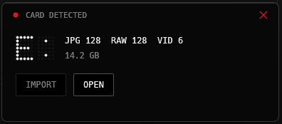

# SWORTA

A small Windows tray app that sorts your camera card for you. Plug in the card, pick a folder, click import, done.

Built for Sony cameras (Alpha series), where photos sit in `DCIM` subfolders and video clips hide in `PRIVATE/M4ROOT/CLIP`. SWORTA stays quiet in the tray and only speaks up when a card or USB drive with a `DCIM` folder shows up.


## What it does

By default everything ends up in one folder per shooting day, split by type:

```
Destination/
└── 260112/
    ├── JPG/    .JPG from DCIM
    ├── RAW/    .ARW from DCIM
    └── VID/    .MP4 and .XML from PRIVATE/M4ROOT/CLIP
```

The folder name is the capture date (`YYMMDD` or `YYYY-MM-DD`), taken from the file's modified time or, for cameras that put it there, from the file name. A shoot that spans two days lands in two folders.

- Detects SD cards and USB drives that contain a `DCIM` folder or the folders of a known camera
- Asks for the destination folder on every import, because every shoot goes somewhere else (can be switched to a fixed folder)
- Imports can be cancelled at any time; files already copied stay, the half-written one is removed
- Several cards can import at the same time, and several files per card are copied in parallel
- Optional speed limit so the import does not choke your drive or network
- Files that already exist at the destination (same name, size and time) are skipped
- Same name but a different file gets a `_1` suffix instead of being overwritten
- Original modified times are kept
- Nothing is ever deleted from the card

## Cameras

SWORTA does not need the camera, only the card. It reads the model name from the first photo or clip, and if there is none it goes by the folders the camera left behind. Sony Alpha and DJI Osmo Action are set up out of the box, anything else is sorted by sensible defaults until you set it up.

Setting up a camera happens on the card itself: plug it in, click **Set up**, and SWORTA lists what it found (`MP4 12 · LRF 12 · JPG 30`). You pick a folder for each file type or leave it empty to skip it, choose how the folders are laid out (`date/type`, `camera/date/type`, …) and optionally a fixed import folder for that camera. If a camera later writes a file type it has no folder for yet, the card says so instead of quietly leaving the files behind.

Two cameras of the same brand can each get their own setup, the more specific model name wins (`ILCE-7M4` over `ILCE-`). If SWORTA cannot tell a card apart at all, pick the camera from the list on the card. That choice is remembered for the card until it gets formatted.

Each camera is a small JSON file. **Export** on the camera page writes it out, **Import file** on another machine adds it, so a colleague can hand you their setup. The built-in ones live in [`cameras/`](cameras), and a pull request with a new file is the easiest way to add one for everybody.

## Notifications

When a card shows up, a small popup appears in the corner of your screen with the card contents and an import button. It stays for a few seconds (or until you close it) and turns into a progress view once the import runs.



If you prefer, switch to normal Windows notifications or turn them off in the settings. "Preview popup" shows you what it looks like.

## Download

Grab the latest build from [Releases](https://github.com/vxnsin/sworta/releases/latest):

- **`SWORTA-Setup.exe`**: the installer (recommended). Installs for your user only, no admin rights needed, adds a Start menu entry and an uninstaller.
- **`SWORTA-Portable.zip`**: no installation, just unzip somewhere permanent (for example `Documents\SWORTA`) and run `SWORTA.exe`.
- `SWORTA.exe` on its own is the bare program the in-app updater downloads. You normally do not need it.

Windows SmartScreen will warn about an unknown publisher on first launch because the files are not code-signed: click "More info", then "Run anyway".

Both variants update themselves the same way, see below.

## Settings


- **Destination**: ask on every import, or use a fixed folder; folder name format
- **Import**: speed limit, files at once (1 to 4 per card), auto import into the last folder, open the folder when done
- **Notifications**: popup, Windows toast or off, and how long the popup stays
- **System**: start with Windows (runs hidden in the tray), automatic updates

Settings live in `%APPDATA%\SWORTA\settings.json`, your cameras in `%APPDATA%\SWORTA\cameras\`.

## Updates

On startup and every few hours after that, SWORTA checks this repository for a newer release. If there is one, it downloads the new exe, swaps it in and restarts itself, never in the middle of an import. If you turn off automatic updates you just get a notice with an install button. You can also check by hand under Settings.

## Build from source

Stable Rust and the MSVC build tools are enough.

```
cargo run              # development
cargo build --release  # target/release/sworta.exe
```

## Publishing a release

1. Bump `version` in `Cargo.toml`
2. Commit and push
3. Tag it: `git tag v0.2.2 && git push origin v0.2.2`

The GitHub Action builds the exe and creates the release. The tag has to match the version in `Cargo.toml` or the build fails. Every installed SWORTA picks the update up on its own.

## License

MIT
